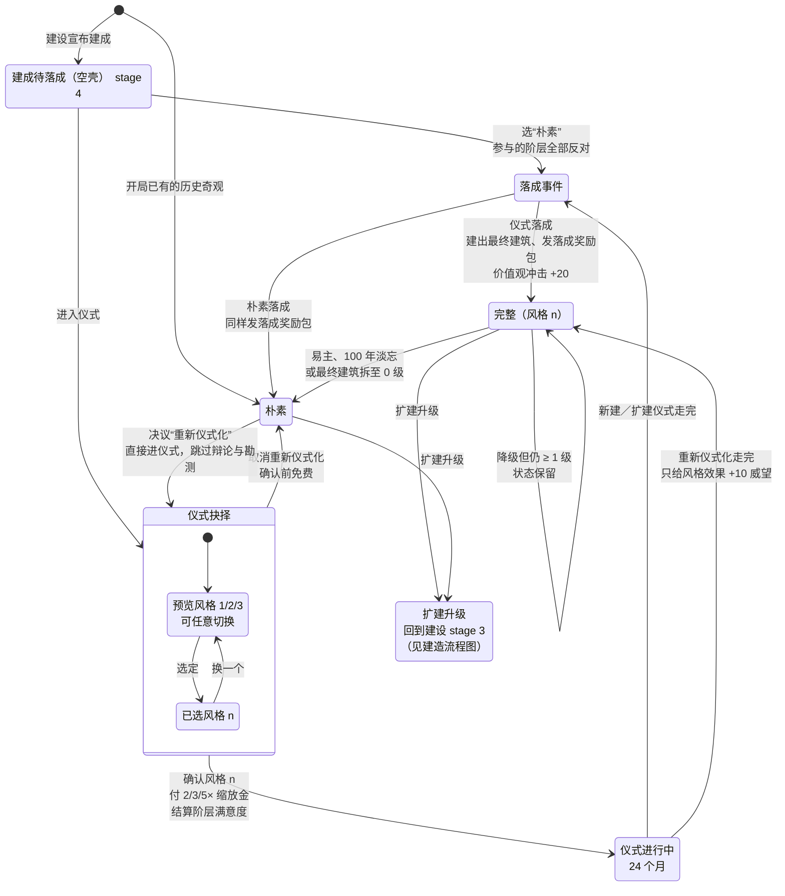

# 奇观玩法状态图（细粒度）

> 配套：[仪式重写实施方案](Wonder_Ritual_Rework_Implementation_Plan.md) §3 状态模型、`data/wonder_ritual_rules.yaml`
> 节点拆到玩家在工程部面板上实际操作的子步骤；为保持可读，拆成“建造主线”和“仪式与生命周期”两张图。

## 一、建造主线（stage 0 → stage 4）

```mermaid
stateDiagram-v2
    direction TB

    state "构想与论证  stage 0" as Concept {
        state "构思中<br/>每月 +总工程师 adm×0.2" as C_think
        state "抽取提案<br/>1–3 个槽位" as C_draw
        state "审阅提案" as C_review
        [*] --> C_think
        C_think --> C_draw: 构思进度满 100
        C_draw --> C_review
        C_review --> C_think: 否决 −10 威望<br/>贿赂 −1× 缩放金
    }

    state "辩论  stage 1" as Debate {
        state "等待阶层诉求" as D_wait
        state "处理诉求" as D_handle
        [*] --> D_wait
        D_wait --> D_handle
        D_handle --> D_wait: 接受 +20 支持<br/>否决 −10 威望 / 贿赂 −1× 金<br/>否决与贿赂都重抽诉求
    }

    state "勘测  stage 2" as Survey {
        state "选择勘测地点" as S_pick
        state "勘测中<br/>每月 +总工程师 mil×0.1" as S_run
        state "三项能力达成<br/>规模 / 后勤 / 组织" as S_comp
        state "锁定工地" as S_lock
        [*] --> S_pick
        S_pick --> S_run
        S_run --> S_comp: 勘测进度满 100
        S_comp --> S_lock
        S_lock --> S_pick: 认为不合适，重跑
    }

    state "建设  stage 3" as Build {
        state "建劳工营<br/>决定工地规模上限" as B_camp
        state "地基" as B_f
        state "主体" as B_b
        state "功能" as B_fn
        state "装饰" as B_d
        state "本级完成" as B_level
        [*] --> B_camp
        B_camp --> B_f
        B_f --> B_b
        B_b --> B_fn
        B_fn --> B_d
        B_d --> B_level
        B_level --> B_f: 修下一级<br/>最高 6 级
    }

    state "建成待落成（空壳）  stage 4" as Shell

    [*] --> Concept: 任命总工程师
    Concept --> Debate: 接受提案<br/>锁定奇观与规模
    Debate --> Survey: 国内支持度满 100
    Survey --> Build: 确认工地
    Build --> Shell: 宣布建成<br/>等级须高于开工时基准
    Shell --> [*]: 进入仪式阶段
```

## 二、仪式与落成后的生命周期（stage 4 起）

## 子步骤与数值

| 阶段 | 子步骤 | 说明 |
| --- | --- | --- |
| 构想与论证 stage 0 | 构思中 | IO 每月 +总工程师 adm × 0.2，满 100 抽取提案 |
| | 抽取提案 | 生成 1–3 个提案槽位 |
| | 审阅提案 | 接受进入辩论；否决 −10 威望、贿赂 −1× 缩放金，两者都退回构思 |
| 辩论 stage 1 | 等待／处理诉求 | 贵族、市民、教士各自有诉求；接受 +20 支持，否决 −10 威望并重抽，贿赂 −1× 缩放金并重抽 |
| | 结束条件 | 国内支持度满 100；上限 200，每月 6 ％ 概率触发 ±20 随机事件 |
| 勘测 stage 2 | 选择勘测地点 | 可重跑勘测换地点 |
| | 勘测中 | IO 每月 +总工程师 mil × 0.1，满 100 完成 |
| | 三项能力达成 | 规模能力决定可建等级上限，后勤能力调整施工进度，组织能力决定劳工营上限（÷5，最多 20 级） |
| | 锁定工地 | 锁定后进入建设 |
| 建设 stage 3 | 建劳工营 | 用原版建造按钮，决定工地规模上限 |
| | 地基 → 主体 → 功能 → 装饰 | 四个部件各 6 级，每单元进度 10 万 / 20 万 / 30 万（小 / 中 / 大） |
| | 本级完成 | 四部件齐备即提升一级，可继续修下一级 |
| | 宣布建成 | 等级须高于开工时基准；空壳续建时主体 ≥ 1 级即可宣布 |
| 仪式抉择 stage 4 | 预览风格 1/2/3 | 切换免费、可任意换；效果预览走原生 effect 渲染 |
| | 确认风格 n | 付 2 / 3 / 5× 缩放金（小 / 中 / 大），结算阶层满意度 |
| 仪式进行中 | 24 个月 | 不扣国内支持度、无负面修正、不能换风格 |
| 落成事件 | 仪式落成 | 建出最终建筑、发落成奖励包、价值观一次性冲击 +20、永久倾向每月 +0.1 |
| | 朴素落成 | 同样发落成奖励包，但参与的阶层全部 oppose |
| 完整（风格 n） | 状态保有 | 易主、100 年淡忘、最终建筑拆至 0 级都会退回朴素；降级但仍 ≥ 1 级时保留 |
| 朴素 | 重新仪式化 | 决议触发，直接进仪式抉择，跳过辩论与勘测；完成后只给风格效果 + 10 威望 |

## 设计要点

**空壳是唯一的分叉点。** 建成后建筑已矗立但没有仪式状态，只给文化传统。此时要么朴素落成（参与的阶层全体反对，但仍发落成奖励包），要么选风格付钱等 24 个月。

**阶层满意度在确认时结算，不在完成时。** 支持该风格的阶层 +0.10，其余 −0.05；因为 3 种风格必然有人不支持，这是有意设计的取舍。

**重新仪式化与新建走同一套仪式，但奖励不同。** 它不给落成奖励包、不建建筑，只给风格效果和 10 威望，完成后构思从头开始。

**扩建是一条约定的回路。** 完整状态的奇观扩建后直接落成、跳过仪式；朴素状态的奇观扩建后要重新选风格。每次扩建各自都能领落成奖励包。
